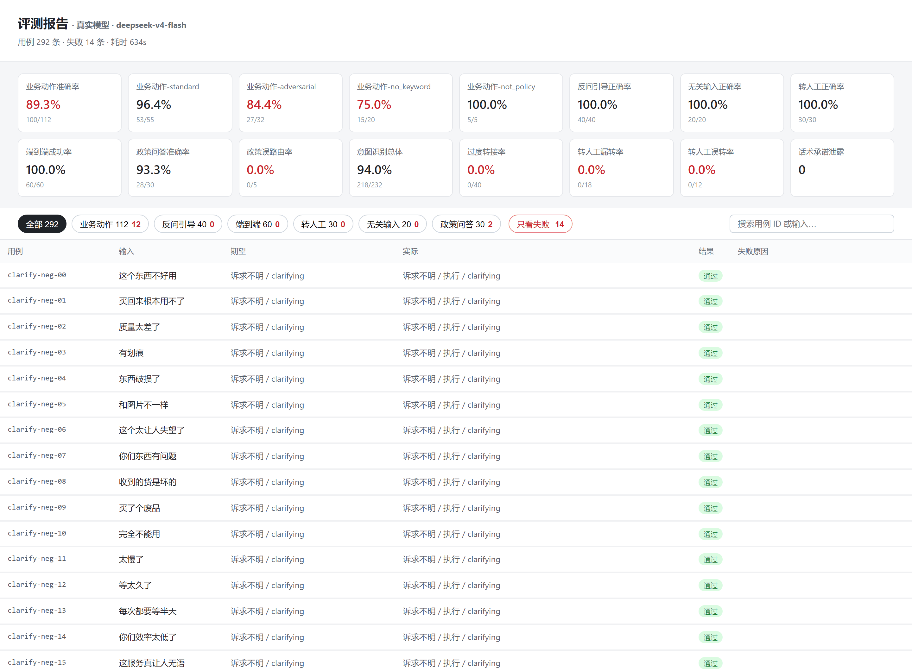

# 售后客服 Agent

面向**售中 + 售后**（订单驱动的服务场景）的客服 Agent。核心不是"能聊天"，而是**不可逆操作可控**、**AI 处理不了时能平稳移交人工**、**每一项能力都有可自动判分的验证**。

本项目按 [GitHub Spec Kit](https://github.com/github/spec-kit) 的 SDD 流程开发：spec → plan → tasks → 实现。宪法见 [`.specify/memory/constitution.md`](.specify/memory/constitution.md)。

## 进度

| Feature | 状态 |
|---|---|
| [001 工具层与 mock 业务服务](specs/001-tool-layer-mock/) | ✅ 完成 |
| [002 Agent 主循环与状态机](specs/002-agent-loop/) | ✅ 完成 |
| [003 转人工链路](specs/003-handoff/) | ✅ 完成 |
| [004 评测集与回归](specs/004-evaluation/) | ✅ 完成 |
| [005 政策 RAG](specs/005-policy-rag/) | ✅ 完成 |
| [006 客服前端（订单页 + 对话页 + 人工工作台）](specs/006-web-ui/) | ✅ 完成 |
| [007 LLM 输出校验重放](specs/007-llm-schema-replay/) | ✅ 完成 |
| 008 催发货（业务动作） | ✅ 完成 |
| 会话记忆（多轮上下文与事实抽取） | ✅ 完成 |

## 催发货：唯一的低风险写操作

Agent 能真的去催单，不只是解释规则。

| 用户说 | 意图 / mode | 系统行为 |
|---|---|---|
| 帮我催一下 · 催催我的订单 | `urge_shipment` / `execute` | **调 `POST /orders/{id}/urge` 真催单** |
| 怎么还不发货 · 订单状态一直是待发货 | `policy` | 回答发货时效：默认 48 小时、超时可催、超 72 小时可仅退款 |
| 能催发货吗 · 超时没发货有赔偿吗 | `policy` | 同上，走 LOGISTICS-01 |

几处刻意的取舍：

- **只有明确要求才写。** 判据是句式而非关键词：祈使句（帮我催、催一下）才判 `urge_shipment`；
  抱怨和问时效（怎么还不发货、一直待发货）都是 `policy`，回答规则而不是替用户去催。
  提到"发货"不等于要催——判错会让系统在用户没授权时动业务系统。
- **不弹确认卡。** 催单可重复、不涉钱、不改变订单状态，用户说「催一下」本身就是授权。但**执行前仍重新查一次订单**，防止说完到执行之间刚好发货。
- **失败如实告知。** 接口超时会回「催单暂时没提交成功，您可以稍后再试或转人工」，不伪装成功——否则用户会一直等一个不存在的商家回应。
- **两层防刷屏。** `request_id` 幂等 + 同订单 1 小时时间窗去重。用户连点会生成新 request_id，只靠幂等键挡不住。
- **数字同源。** 48 小时 / 24 小时同时存在于配置项和条款 `params`，有单测锁死两者一致，避免「话术说 48、条款说 72」。


## LLM 输出校验重放（007）

模型是概率系统，`response_format: json_object` 只保证"是 JSON"，不保证"字段对"。
此前结构不合法就直接抛错，`with_retry` 用**同一句 prompt** 在温度 0 下重试三次——
大概率复现同一个错，最后降级说"系统繁忙"，用户根本不知道是模型没按格式回。

现在改成**带错误重放**：

| 阶段 | 行为 |
|---|---|
| 首次返回 | 经严格校验器（`app/agent/llm/schema.py`）整体校验，任一字段非法即整体失败 |
| 失败后 | 把上一轮原文 + **可执行的错误说明**（报字段名、期望取值、实际收到什么）一起喂回去重放 |
| 重放次数 | 可配 `MOCK_SCHEMA_REPLAY_ATTEMPTS`，默认 1（每加 1 = 多一次模型调用） |
| 仍失败 | 标记会话 `schema_retries_exhausted`，本轮降级不猜意图；**下一轮**直接按 SYSTEM_ERROR 转人工 |

三条刻意的取舍：

1. **整体校验，不部分采纳。** 截断输出里可能恰好包含合法的 `{"intent":"refund"`，
   允许"只取能解析的部分"就等于让一次模型抽风变成一次真实退款。
2. **`mode` 是必填字段。** 缺字段就按 EXECUTE 兜底，等于模型少写一个字段就能退钱。
   上线前实测过：真实模型在 172 条意图识别样本里漏 `mode` 的比例为 **0%**，改必填是安全的。
   显式 `mode: null` 仍被接受（模型对 unknown 类输入常这么回）。
3. **结构失败不再走三次盲重试。** 客户端已经带错误重放过，再盲重试只是拖长等待。

指标在 `/agent/health/llm`：`schema_replays` 多而 `schema_failures` 少 = 模型偶尔抽风；
`schema_failures` 多 = prompt 或模型能力不匹配，该改 prompt 而不是加大重放次数。

## 会话记忆（多轮上下文）

用户常把一件事拆成几句话：先「我那单想退货」，再「上周买的保温杯」，最后才给订单号。
在此之前，每轮进模型的上下文只有 `{order_id, intent}` 两个字段，前两句的信息每轮都丢，
只能反复追问。

现在分两层存，职责不同：

| 层 | 内容 | 用途 |
|---|---|---|
| **结构化事实** `facts` | 订单号、金额、相对时间、诉求 | 跨轮不丢，写进 system prompt |
| **原文窗口** `recent_turns` | 最近 6 条消息（含助手回复），上限 1500 字 | 只用于理解「那单」「这个」指代 |

两者都存在 `SessionState`（Redis，24h）。请求结构从「system + 一条 user（上下文拼成字符串）」
变成真正的多轮：

```
system    意图规则 + 【已知事实】订单号：ORD1002；诉求：退款
user      我要退款
assistant 请确认：即将为订单 ORD1002 提交退款 300 元，确认吗？
user      上周买的保温杯          ← 本轮
```

三条刻意的取舍：

1. **事实用规则抽，不调模型。** 订单号 / 金额 / 相对时间都是正则能覆盖的，
   为记住一个订单号每轮多花一次模型调用（内网单次 20~40 秒）不划算。
2. **事实与原文分开。** 窗口会被裁剪，事实不会；历史原文只用于理解指代，
   不参与意图判定——历史里那句「我要退款」可能只是抱怨。
3. **低信息轮次不占窗口。** 「嗯」「好的」这类短确认不记录，避免把窗口挤满。

开关：`MOCK_MEMORY_ENABLED`（默认开，可一键回到改造前）、`MOCK_MEMORY_RECENT_TURNS`、
`MOCK_MEMORY_MAX_CHARS`、`MOCK_MEMORY_FACTS_MAX`。

## 政策 RAG 演进（005 之后）

005 交付时是**纯向量检索 + 阈值判定**，实测有两类问题：答非所问（「能合并订单发货吗」
召回「修改收货地址」0.742 并直接生成答案）、以及知识棘手的例外条款够不着。之后补了四层：

| 层 | 作用 | 关键约束 |
|---|---|---|
| **真实 embedding** | `bge-small-zh-v1.5` 替换 demo 用的伪向量 | 不配 `MOCK_RAG_EMBEDDER=bge` 时退回 stub |
| **关键词召回** | 2~4 字 n-gram + RRF 融合，救实体词与例外条款（「吊牌被摘剪」只写在 exceptions 里，embedding 刻意排除了它） | 阈值判断始终只看向量余弦，融合分仅用于排序 |
| **LLM rerank** | 检索后、生成前交叉复核「这条条款真能回答问题吗」 | 只能降级不能升级；失败回退向量排序；全剔除 → miss |
| **查询改写** | 意图识别同一次调用顺带产出检索词，不新增模型调用 | 只喂检索层，rerank 与生成仍用用户原话；改写 miss 时回退原文再查一次 |

**知识库答不了 → 直接转人工（BOUNDARY）**：不论 rerank 全剔除（条款存在但都答不上）
还是检索层没找到候选（分数不够 / 被品类过滤掉），对用户来说都是"没有答案"。
按产品口径**一律转人工**，不消耗用户轮次去反问。

真机实测（bge + 内网模型）：5 个答非所问案例全部挡住；「吊牌被剪了」从原文 0.523
检索层 miss，改写后 0.735 命中正确条款。

> **代价**：政策链路从「检索 + 生成」变成「检索 + rerank + 生成」，每题多一次模型调用，
> 内网慢模型下单次问答 20~40 秒。`rag_timeout_ms` 已调到 90 秒（默认 30 秒会超时）。

## 评测结果

302 条用例，按**处理路径**判分（业务动作 / 澄清 / 转人工 / 无关输入 / 政策 / 端到端）。
下表为 `--llm=real`（deepseek-v4-flash）的实测数字，跑批日期见表格脚注；
桩（`--llm=stub`）的报告准确率虚高，**不可对外引用**。

跑完自动生成 HTML 报告并打开（`eval/report/latest.html`，支持按路径筛选、搜 ID、只看失败）：



| 指标 | 结果 | 说明 |
|---|---|---|
| 过度转接率 | **0.0%** (0/40) | 反问引导类里实际转人工的比例，衡量人工成本损耗 |
| 转人工漏转率 | **0.0%** (0/18) | 该转没转的比例 |
| 转人工误转率 | **0.0%** (0/12) | 不该转却转了 |
| 转人工正确率 | **100%** (30/30) | |
| 反问引导正确率 | **100%** (40/40) | |
| 意图识别总体 | **92.9%** (221/238) | |
| 政策问答准确率 | **96.7%** (29/30) | `bge` 单独跑 31 条的结果；全量跑批用 stub embedder 时的 76.7% 不可引用 |
| 政策误路由率 | **0.0%** (0/5) | 政策问题被误判成业务动作 |
| 端到端成功率 | **98.4%** (62/63) | 多轮跑完整业务链路 |
| 无关输入正确率 | **100%** (20/20) | |
| 话术承诺泄露 | **0** 次 | 反问引导话术不得出现「退款/退换/补偿」等承诺 |
| 业务动作准确率 | **91.5%** (108/118) | 含 adversarial / no_keyword 等难样本 |
| ├ standard | 98.3% (58/59) | 标准表述 |
| ├ adversarial | 88.2% (30/34) | 对抗表述（威胁、否定、转述） |
| └ no_keyword | 75.0% (15/20) | 不含意图关键词的诉求 |

> **跑批口径（2026-11-24）**：301 条用例、串行、`deepseek-v4-flash`。非检索类指标用 `stub`
> embedder（不影响意图与流程判定）；政策问答准确率为同日 `bge` 单独跑 31 条的结果，两者口径
> 不同，不要横向比较绝对值。此后新增了 2 条多轮记忆用例、政策用例拆分 1 条（现共 302 条），
> 下次统一口径跑批后更新本表。

失败用例可在报告页直接筛出，查看输入、期望、实际三列对照。

> **数字口径**：`temperature=0` 只降低随机性，不消除随机性。同一条输入多次调用
> 仍可能判定不同（实测「再不处理我就投诉你们不肯退款」5 次中 4 次判 refund、
> 1 次判 unknown），所以单次跑分有噪声，比较两个版本时看多次运行均值。

> **转人工口径（2026-11-13）**：意图体系收敛为 6 个业务意图 + `unknown` 兜底。
> 删除 `complaint` / `general` 两个语义桶——抱怨、投诉措辞、扬言监管一律判 `unknown`，
> 只安抚道歉，不追问、不转人工、不调工具。**转人工只由用户主动触发**（点击按钮 /
> 说"转人工"），外加系统异常与能力边界两条例外。断言见
> `backend/scripts/verify_intent_boundary.py`。

**重跑方式**：

```bash
# 串行跑，并发会把内网网关打到限流降级
python -m eval.runner --llm=real --embedder=bge --concurrency=1
python -m eval.runner --llm=stub                    # 秒级，仅验链路
```

真实模型跑批的耗时与限流注意事项见 [docs/troubleshooting.md](docs/troubleshooting.md)。

回归阈值：总体 3 个百分点、关键单项 5 个百分点、硬性项（承诺泄露 / 降级期写操作 /
静默违规）**0 容忍**，超阈值即输出阻断原因，不是只给退出码。

## 快速开始

```bash
uv venv
uv pip install -e "backend[dev]"

# 起服务（含 Agent 与业务接口）
cd backend && uvicorn app.main:app --reload

# 跑测试
cd backend && PYTHONIOENCODING=utf-8 python -m pytest -q
```

> **真实 embedding（可选）**：`.env` 里配 `MOCK_RAG_EMBEDDER=bge` 才走真模型，需要额外装
> `sentence-transformers`。版本锁、镜像下载、离线加载、超时设置等环境细节见
> [docs/troubleshooting.md](docs/troubleshooting.md)。不装也能跑——设成 `stub` 即可，
> 只是相似度是伪随机的；**测试永远用 stub**。

前端：

```bash
cd frontend
npm ci
npx playwright install chromium   # E2E 需要
npm run dev                        # 开发模式，代理到 :8000
npm run typecheck && npm run test && npm run build
```

> **本地无 Redis 时**可用 `dev_server` 启动（fakeredis 顶替），见
> [docs/troubleshooting.md](docs/troubleshooting.md)。

构建产物进镜像后由后端托管：

```bash
cd frontend && npm run build
mkdir -p ../backend/app/static && cp -r dist/* ../backend/app/static/
```

或用 Docker（**两阶段**：阶段 1 `npm run build` 含 `vue-tsc` 类型检查，
前端构建或类型检查失败即镜像构建失败）：

```bash
docker compose up --build
# 打开 http://localhost:8000
```

## 演示级限制（务必知悉）

本项目**不是可上线形态**，以下为刻意简化：

- **无登录**：会话 ID 即凭证；任何人拿到 sessionId 即可读该会话
- **无订单归属校验**：订单表没有 `user_id`，从订单页带入的 `order_id` 后端无法验证归属
- **人工端固定账号**：`demo-agent / 小王`，无账号体系
- **不做 CI**：前端构建仅在 Dockerfile 与人工执行时校验（宪法 FR-021 无自动阻断机制）
- **不分页**：会话列表与队列全量返回，上限 200 条
- **镜像数据不持久**：Docker 入口用 `dev_server`（fakeredis），重启即清空队列、会话与消息
- **政策库覆盖不全**：退货方式、分期付款、门店退货等主题**没有对应条款**，
  问到这类问题会直接转人工（知识库没有答案），用户由人工解答
- **投诉不自动转人工**：扬言投诉/监管/差评由 AI 安抚，不进人工队列。
  若业务上需要人工介入，需用户在界面上主动点转人工

详见 [specs/006-web-ui/plan.md](specs/006-web-ui/plan.md) 的风险与待确认项。

## 设计取舍

| 决策 | 为什么 |
|---|---|
| 只做售中 + 售后 | 边界由业务入口自然划出：有订单才有售中售后。售前"好"的标准无法客观定义，会毁掉可自动判分的评测集 |
| 单 Agent + 显式状态机 | 售后流程线性、顺序敏感，正是多 Agent 的弱项 |
| 优先级是纯规则函数 | 决定真人的工作分配，必须可复现、可向主管解释 |
| 业务失败返回 HTTP 200 + 数字码 | 调用方读 `code` 分流，不用从异常里区分业务与传输 |
| 故障注入按请求维度 | 全局生效会让评测中一个用例污染其他并发用例 |
| 业务数据内存态 + 种子 | 重启回到初始状态，保证评测可复现 |

## 目录

```
├── .specify/            SDD 宪法、模板、脚本
├── specs/              每个 feature 的 spec / plan / tasks / contracts
├── backend/            Python + FastAPI 服务
├── frontend/           Vue3 + TS
├── docs/               环境与踩坑记录、评测报告截图
└── _prototype/         引入 SDD 前的原型代码（仅供对照，不要在此继续开发）
```

## 已知范围外

- 真实接入第三方电商 / 物流平台 API
- 用户侧产品能力（注册登录、商品浏览、下单支付）
- 多渠道接入、客服排班与绩效
